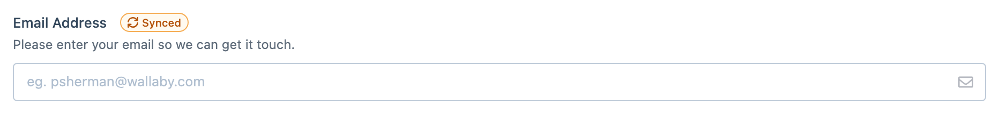

# Synced Fields

Synced fields let you reuse the same field across multiple forms.

They are useful when a field should stay consistent everywhere it appears, instead of becoming a separate copy in each form. When a field is added as a synced field, Formie links it to the original field, so changes made to one instance are reflected everywhere that synced field is used.

This is especially useful for fields that appear repeatedly across a site, such as email addresses, phone numbers, consent checkboxes, and other common contact details.

## When to Use Synced Fields

Synced fields are a good fit when:

- the field should behave the same way in every form
- you want one change to update every use of that field
- you are trying to avoid duplicated maintenance

They are a poor fit when a field only looks similar but needs to drift over time. In that case, a normal copied field is usually the better choice.

## Adding a Synced Field

In the form builder, add a field from the existing fields picker instead of creating a new one. When you choose an existing field, you can add it as a synced field so it stays linked to the original.

That same picker can also add a normal copied field instead. The difference is important:

- a copied field starts as a duplicate, then becomes independent
- a synced field stays linked

Because the field stays linked, editing it in one form means editing it everywhere. That is what makes synced fields useful, but it is also why they need a little more care.

## Synced Fields Inside Groups

You can add existing or synced fields inside **Group** fields from the form builder. This is useful when you want independent group wrappers — such as delivery and invoice address blocks — that each contain the same synced field.

Each group keeps its own label and settings, while synced nested fields share their settings across groups. Submission values are namespaced by the group handle, for example `deliveryAddress.email` and `invoiceAddress.email`.

## Working with Shared Fields

Formie warns you about this in the builder, but it is still worth being deliberate. If you need an independent version later, the usual answer is to create a new field rather than trying to keep changing a shared one.

## Synced Fields in Stencils

You can add synced fields while building a [stencil](/forms/stencils). The stencil stores the synced field’s unique identifier (UID) so new forms created from that stencil link to the same field.

Project stencils resolve synced fields by UID, so the matching synced field must already exist on each environment. Otherwise, Formie creates an independent copy from the stencil field settings. Importing a form that uses the synced field can create that field first.

## Moving Synced Fields Between Environments

[Form import and export](/forms/import-export#importing-synced-fields) can preserve synced-field relationships. Import each form with **Preserve relationships**: the first import creates a missing synced field, and later imports reuse it by UID. Matching labels or handles alone do not link fields.

The import preview lets you keep destination settings, update a synced field across its listed forms, or import independent fields. **Required** can be set separately wherever the field appears. Review the affected forms before choosing **Update synced field**.

## Synced Fields and Multi-Site

A synced field shares its label, handle, and settings wherever it appears across forms.

On multi-site projects, [content translation overrides](/forms/multi-site#content-translation) for shared content such as labels apply wherever the synced field appears on that site. **Required** can be set separately for each use of the field. That means:

- editing a synced field on the form’s **source site** updates its shared settings, affecting every form and every site without an override for those settings
- translating shared content on a **secondary site** leaves the source settings unchanged while applying that translation wherever the synced field is used on that site
- changing **Required** on a secondary site affects only that use of the field on that site
- if the same synced field appears twice on one form — for example inside delivery and invoice groups — one can be required while the other remains optional on the same site

If you need completely different labels or behaviour per site without sharing settings, use a copied field instead of a synced one.
